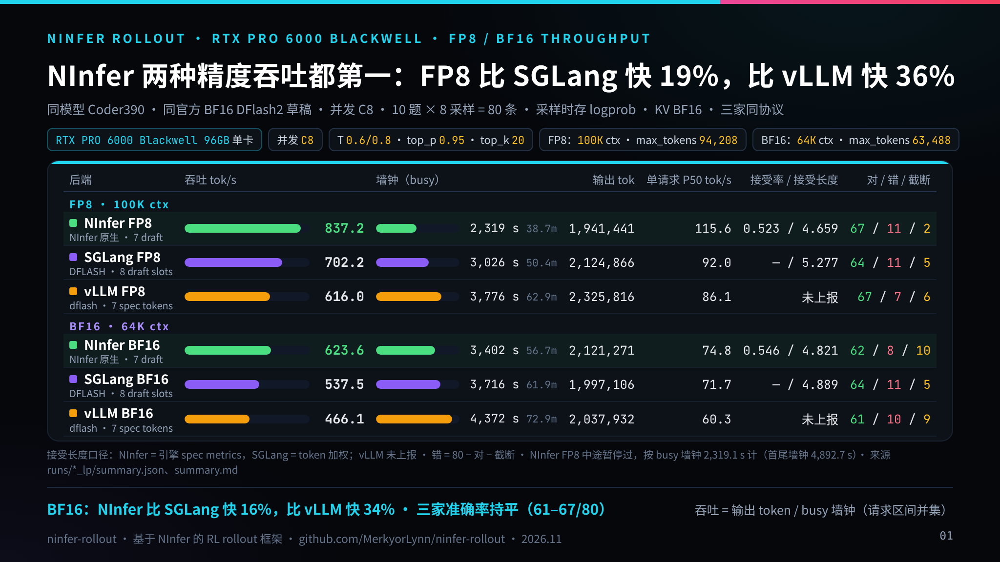
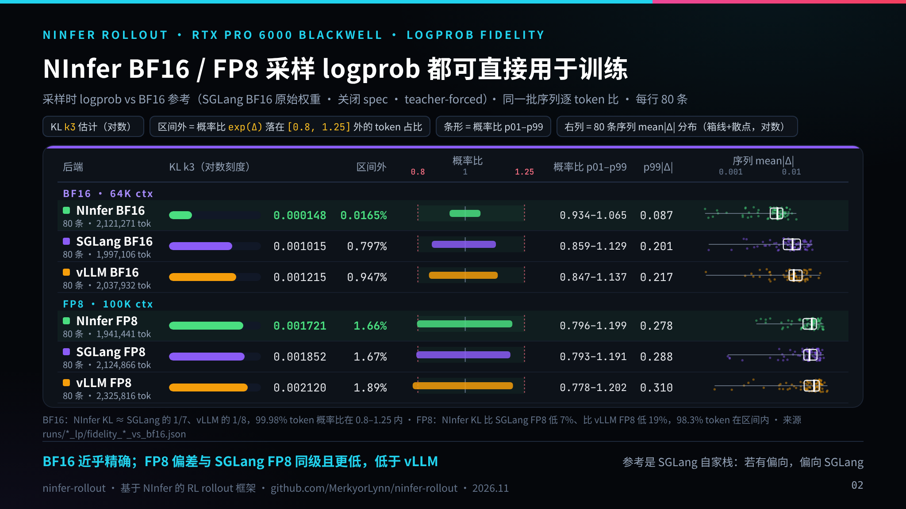

# NInfer Rollout — 基于 NInfer 的 RL rollout 前向采样/打分框架





ninfer-rollout 是基于 NInfer 的 RL rollout 引擎：输出走 HTTP，直接提供 OpenAI 兼容接口，on-policy 采样时直接返回 token id 与采样 logprob。

- **效率第一**：单卡 RTX PRO 6000，FP8 吞吐 837 tok/s，比 SGLang 快 19%、比 vLLM 快 36%；BF16 分别快 16% / 34%。
- **精度第一**：BF16 采样 logprob 对 BF16 参考的 KL 仅 0.000148，约为 SGLang 的 1/7、vLLM 的 1/8；FP8 为 0.001721，同样三家最低，可直接用于训练。
- **同时兼容 on-policy 与 off-policy**：on-policy 直接用采样时 logprob；off-policy 可走 teacher-forced 打分（POST /generate，与 SGLang 兼容）补算 logprob。

推理内核（DFlash2 投机解码、FP8）沿用上游，未改采样分布。

## 上游基础

基于 [Neroued/ninfer](https://github.com/Neroued/ninfer) 的 [`81c8ce093b2c1646a87566a8e59d807fcf0ec95c`](https://github.com/Neroued/ninfer/commit/81c8ce093b2c1646a87566a8e59d807fcf0ec95c)（2026-10-07），许可证 [Apache-2.0](LICENSE)。

## 相对原版新增

- **独立打分端点 `POST /generate`**：给一串 token id 做 teacher-forced 打分，返回逐 token logprob，作为 trainer 的 `old_logprobs`。与生成共用同一份权重显存，但使用独立的 KV 缓存和 CUDA 流，且不走投机解码，因此分数来自主模型的原始分布。用 `--rollout-score` 开启，用 `--rollout-score-context` 设置打分上下文长度。
- **返回采样出的原始 token id**（[`be0991f`](https://github.com/MerkyorLynn/ninfer-rollout/commit/be0991f)）：请求带 `"return_token_ids": true` 时，响应顶层给出 `prompt_token_ids` 和 `completion_token_ids`（含投机解码接受的 token 和最后的停止 token）。打分时直接用这两组 id，不要把文本重新分词。
- **采样时逐 token logprob**：非流式 `/v1/chat/completions` 请求带 `"logprobs": true` 时，`choices[0].logprobs.content` 按顺序给出每个输出 token 的 logprob，与 `completion_token_ids` 一一对应（长度等于 `usage.completion_tokens`）。数值在采样当轮直接从主模型 logits 算出，投机解码接受的草稿 token、拒绝后重采的 token 和 bonus token 都有。`logprob` 是全词表、温度 1 的原始 logprob（trainer 用的口径，与 `/generate` 打分同一公式）；`sampling_logprob` 是实际采样分布（temperature、top-k、top-p 截断后）下的 logprob；`kind` 标明 token 来源。详见 [CONTRACT.md](rollout/CONTRACT.md#采样时-logprob)。
- **支持 DGX Spark**：原版只接受 `CMAKE_CUDA_ARCHITECTURES=120a`，这里放开到 `121` 和 `121a`。
- **兼容旧版 tokenizer**（[`390b4d1`](https://github.com/MerkyorLynn/ninfer-rollout/commit/390b4d1)）：能加载 Qwen 旧格式的 Split pre-tokenizer，以及缺少 `added_tokens_decoder` 的 `tokenizer_config`。部分 Qwen3.8 微调模型带的就是这种格式，原版会加载失败。
- **配套工具**：[`rollout/`](rollout/) 目录里有 Python 客户端、[采样/打分约定](rollout/CONTRACT.md)、验收探针 `probe.py` 和测试。

## 编译与启动

RTX PRO 6000 编 `120a`，DGX Spark 编 `121a`。不要把 `121a` 二进制拿到 RTX PRO 6000 上跑。更完整的说明见 [BUILD-PRO6000.md](BUILD-PRO6000.md)。

```bash
cmake -S . -B build-sm120a -DCMAKE_BUILD_TYPE=Release -DCMAKE_CUDA_ARCHITECTURES=120a
cmake --build build-sm120a -j --target ninfer-serve
```

启动（开启打分端点，DFlash2 投机解码）：

```bash
./build-sm120a/apps/ninfer-serve MODEL.ninfer \
  --spec dflash2 --draft-tokens 7 \
  --rollout-score --rollout-score-context 8192 \
  --host 127.0.0.1 --port 19421 --model-id ninfer-rollout
```

验收：

```bash
python3 rollout/probe.py --base http://127.0.0.1:19421 --model ninfer-rollout --context-length 8192
```

## 预编译二进制

[v0.1.0-sm120a-390b4d1](https://github.com/MerkyorLynn/ninfer-rollout/releases/tag/v0.1.0-sm120a-390b4d1) 提供 `sm_120a`、CUDA 13 的 `ninfer-serve` 预编译包，对应提交 `390b4d1`。可在 RTX PRO 6000 / 6000D 上直接解压使用，无需现场编译。Spark 需要自行按 `121a` 编译。

运行前需安装 NVIDIA 驱动、CUDA 13 运行时 `libcudart.so.13`、FFmpeg 6 相关动态库，以及 `libcurl`。解压后在目标机上执行 `ldd ninfer-serve`，确认没有缺失的库。

## 采样约定

详细约定见 [`rollout/CONTRACT.md`](rollout/CONTRACT.md)。摘要：

- 每条 prompt 采 8 个样本：前 4 条 `temperature=0.6`，后 4 条 `temperature=0.8`。
- `seed = seed_base + prompt_index * 100 + sample_index`。
- 当 `prompt_tokens + completion_tokens` 超过 102400 时，该样本记为删失（censored），**保留全文，不做右截断**。
- 截断和死循环样本建议完整保留，只在元数据里标记，不要过滤掉——它们是有用的训练材料。

## 结果

对照评测在 RTX PRO 6000D 上测试，结果稍后补充。标准版 RTX PRO 6000 预计会快约 20%。
