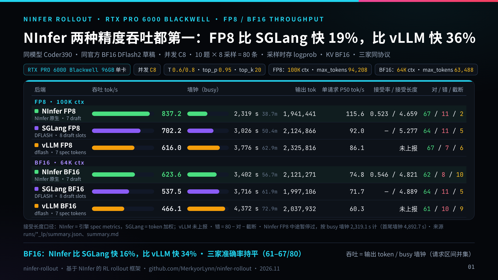
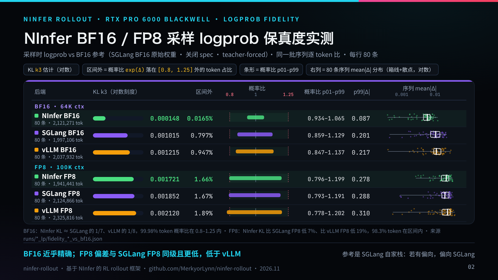
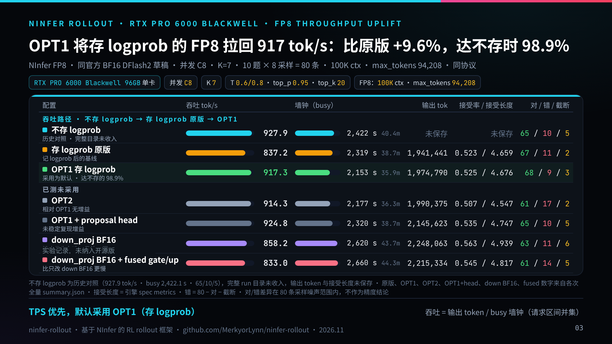
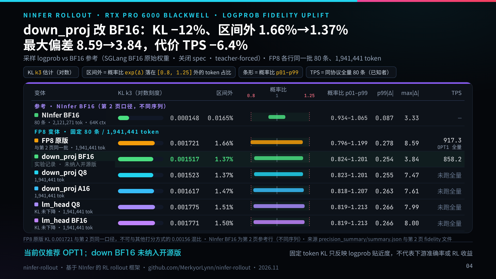

# RTX PRO 6000 rollout 实测：NInfer vs SGLang vs vLLM

单卡 RTX PRO 6000 Blackwell 96GB，开启逐 token logprob 返回：NInfer（OPT1）比 SGLang 快 31%、比 vLLM 快 49%。

在大模型强化学习（RL）工程中，性能瓶颈往往不在训练本身，而在前面的 rollout 采样阶段。推理端既要用低精度量化提升吞吐，又要返回每个采样 token 的完整 logprob 供训练端复用；处理不好，要么吞吐明显下降，要么数值误差引入额外的 off-policy 偏差。

最近我在单张 RTX PRO 6000（96GB）显卡上，基于自己的 Qwen3.8-27B-Coder390 模型，对 NInfer、SGLang 和 vLLM 三家推理引擎做了一轮同口径实测，重点评估存 logprob 时的吞吐表现与数值保真度。

## 核心结论

- **吞吐表现**：在 8 并发（C8）、带完整 logprob 的 FP8 采样测试中，启用 OPT1 后 NInfer 达到 917.3 tok/s，比 SGLang（702.2）快 31%，比 vLLM（616.0）快 49%。即便是未优化的原版实现，NInfer 在 FP8 和 BF16 下吞吐也均排第一：FP8（100K 上下文）837.2 tok/s，比 SGLang 快 19%，比 vLLM 快 36%；BF16（64K 上下文）623.6 tok/s，比 SGLang 快 16%，比 vLLM 快 34%。三家答题准确率基本持平，均在 61–67/80 之间。
- **存 logprob 的吞吐开销优化**：消除投机解码中的重复概率计算后（OPT1 优化，草稿长度 K=7），NInfer FP8 存 logprob 的吞吐从 837.2 提升至 917.3 tok/s（+9.6%），达到不存 logprob 时（927.9 tok/s）的 98.9%。
- **logprob 保真度**：以 SGLang BF16 关闭投机算出的 logprob 为参考，按逐 token 平均 KL 散度衡量，NInfer BF16 为 0.000148，概率比落在 [0.8, 1.25] 区间外的 token 仅占 0.0165%；NInfer FP8 的 KL 为 0.001721（区间外 1.66%），比 SGLang FP8 低 7%，比 vLLM FP8 低 19%。
- **敏感层定位与混合精度实验**：在本次固定 token 对照中，将 FP8 模型的前馈网络 down_proj 层保留为 BF16 后，KL 降低 12%（0.001721 → 0.001517），区间外占比从 1.66% 降至 1.37%，单 token 最大偏差从 8.59 降至 3.84，代价是吞吐下降 6.4%（917.3 → 858.2 tok/s）。将词表输出头 lm_head 改为 Q8 或 BF16 则未改善 KL。该混合精度方案仅保留为实验记录，未纳入当前开源版本。
- **配置选型建议**：当前开源版本仅保留并推荐 OPT1（FP8 + 存 logprob，917.3 tok/s）。down_proj BF16 不作为当前可选配置；是否重新引入，需由后续端到端训练收益和更充分的性能复测决定。

## 背景：存 logprob 为什么面临吞吐与保真度的权衡？

在 PPO 或 GRPO 等策略梯度算法中，训练阶段需要计算重要性采样比，即当前训练策略概率与采样时旧策略概率的比值。为了省去训练端对整段序列重新做一次 forward，工程上的常规做法是让推理引擎在采样时直接返回每个 token 的 logprob。

这一做法对推理端提出了两个数值要求：

**第一**，必须区分两种 logprob 口径：原始模型分布下的 logprob 用于与训练端重算结果对照；实际采样分布下的 logprob 则基于温度（temperature）、top-p、top-k 等处理后的分布，并需在截断后的候选集合上正确归一化。只返回前几个候选词的局部近似值，或把两种口径混用，都无法满足要求。本实现同时返回 `logprob`（temperature=1 的原始全词表分布）和 `sampling_logprob`（实际采样分布）。

**第二**，推理端输出的 logprob 需尽量贴近训练端的重算数值。推理端为了提速，往往同时引入 FP8 量化、投机解码以及定制底层算子，而训练端通常以 BF16 重算。若训练算法直接使用这些数值计算重要性采样比，两端差异会形成额外的 off-policy 偏差；具体影响取决于算法采用的 logprob 口径和修正策略。

这两项要求都会消耗吞吐。

一方面，计算完整 logprob 有可观的算力开销。开启投机解码后，每轮需要验证 K 个草稿 token，每个位置都要在十几万量级的词表上做一次 logsumexp。实现不够紧凑时，这一步会带来 10% 左右的吞吐损失——实测 FP8 开启存 logprob 后，吞吐从 927.9 降至 837.2 tok/s。

另一方面，FP8 量化虽然显著快于 BF16，但量化误差也会使 logprob 偏离 BF16 参考值更远。因此本次测试主要回答两个问题：存 logprob 带来的吞吐损失能消除多少？FP8 的量化误差主要来自哪一层，能否以较低的吞吐代价换回更高的保真度？

## 吞吐对比：两种精度下的实测表现

三家引擎在统一条件下进行测试：

- 硬件：单张 RTX PRO 6000 Blackwell（96GB），模型为 Qwen3.8-27B-Coder390 同一份权重（FP8 和 BF16 两版），KV cache 统一使用 BF16。
- 投机解码：全部挂载同一个官方 BF16 DFlash2 草稿模型，NInfer 草稿长度 K=7，SGLang 8 个草稿槽位，vLLM 7 个投机 token。
- 负载：10 道题 × 8 次采样 = 80 条请求，8 并发；温度 0.6 / 0.8、top_p 0.95、top_k 20。
- 上下文：FP8 为 100K（最大输出 94,208），BF16 为 64K（最大输出 63,488），全程返回完整 logprob。
- 吞吐 = 输出总 token 数 ÷ busy 墙钟时间（所有请求时间区间的并集）。

如图 1 所示，此时 NInfer FP8 运行的仍是未优化的原版存 logprob 实现，在两种精度下吞吐均排第一：

- **FP8（100K）**：NInfer 837.2 tok/s（busy 墙钟 2,319 秒，输出 1,941,441 token，单请求 P50 115.6 tok/s，对/错/截断 67/11/2）；SGLang 702.2 tok/s（3,026 秒，2,124,866 token，P50 92.0，64/11/5）；vLLM 616.0 tok/s（3,776 秒，2,325,816 token，P50 86.1，67/7/6）。
- **BF16（64K）**：NInfer 623.6 tok/s（3,402 秒，2,121,271 token，P50 74.8，62/8/10）；SGLang 537.5 tok/s（3,716 秒，1,997,106 token，P50 71.7，64/11/5）；vLLM 466.1 tok/s（4,372 秒，2,037,932 token，P50 60.3，61/10/9）。

从投机指标来看，FP8 下草稿的平均接受长度，NInfer 为 4.659（接受率 0.523；BF16 下为 0.546 / 4.821），SGLang 则更高，达到 5.277（BF16 下为 4.889；vLLM 未上报该项，两家统计口径也略有不同）。SGLang 单轮接受的 token 更多，总吞吐却比 NInfer 低 19%，说明性能差距主要在单轮验证本身的计算开销，而非草稿接受率。

补充两点口径说明：NInfer FP8 运行中途曾暂停，首尾墙钟为 4,892.7 秒，因此按 busy 墙钟 2,319.1 秒计算；此外各家采样轨迹不同导致输出总 token 数不同，按 tok/s 对比才公平，而 80 道题上相差几道对错属于随机采样波动，不能作为精度结论。

## logprob 保真度：采样概率与参考值的偏差对比

为了检验采样输出的 logprob 是否准确，我用 SGLang 加载 BF16 原始权重、关闭投机解码，对各家生成的同一批文本做 teacher-forced 前向重算，将其输出的 logprob 作为参考标准。该参考值出自 SGLang 自身的推理栈，若存在系统性偏向，也是偏向 SGLang。

评估采用两个指标：

- **k3 估计的逐 token 平均 KL**：参考概率除以采样概率得到比值 r，计算 (r − 1) − log r 再求平均，保证非负且方差小，适合"token 数量多但每个位置仅采样一次"的场景。
- **概率比落在 [0.8, 1.25] 外的 token 占比**：对应 PPO 在 clip 阈值 ε=0.2 时触发截断的 token 比例。

图 2 结果如下：

**BF16 档**：NInfer 平均 KL 仅为 0.000148，约为 SGLang（0.001015）的 1/7、vLLM（0.001215）的 1/8。NInfer 区间外占比仅为 0.0165%，即 99.98% 的 token 概率比落在 0.8–1.25 内（p01–p99 为 0.934–1.065，p99|Δ| 0.087）；SGLang 和 vLLM 分别为 0.797%（0.859–1.129，0.201）和 0.947%（0.847–1.137，0.217）。

这里 SGLang 自身的对照数据值得关注：参考标准本身由 SGLang 关闭投机算出，但其开启投机与并发采样后，KL 仍升至 0.001015。这说明投机解码叠加并发 batch 带来的数值漂移，明显大于"同权重同精度必然一致"的直觉预期。

**FP8 档**：三家区间外占比在 1.66%–1.89% 之间：NInfer 为 1.66%（0.796–1.199，p99|Δ| 0.278），SGLang 为 1.67%（0.793–1.191，0.288），vLLM 为 1.89%（0.778–1.202，0.310）。平均 KL 上，NInfer 为 0.001721，比 SGLang（0.001852）低 7%，比 vLLM（0.002120）低 19%。可见 FP8 误差的主要来源是权重量化本身，推理引擎的实现决定了在此基础上额外引入多少数值误差。

需要说明的是，这里评估的仅是采样 logprob 贴近参考值的程度，不等同于下游训练效果。1e-3 量级的 KL 对 RL 训练的实际影响取决于具体算法的截断和重要性采样修正策略，本文未做端到端训练实验。

## OPT1：消除投机验证中的重复 logprob 计算

NInfer FP8 不存 logprob 的历史对照吞吐为 927.9 tok/s（busy 墙钟 2,422 秒，65/10/5），开启原版存 logprob 后降至 837.2。优化前后的吞吐对比见图 3。

启用 OPT1 后，返回完整 logprob 的 FP8 吞吐提升至 917.3 tok/s（busy 墙钟 2,153 秒，输出 1,974,790 token，接受率 0.525、接受长度 4.676，68/9/3）。这比原版快 9.6%，达到不存 logprob 时的 98.9%——按差值计算，存 logprob 造成的吞吐损失消除了约 88%，剩余额外开销仅约 1%。

OPT1 的核心改动是消除投机验证阶段的重复计算。原版实现中，DFlash2 验证草稿时已经构造过经过温度、top-p、top-k 处理的目标分布，后续为记录 logprob 又重新计算了一遍。OPT1 改为在验收阶段直接记录已构造好的目标分布 logprob，后续仅补算一次原始全词表 logsumexp。对于修正词（correction token），`sampling_logprob` 记录其在边际目标分布下的概率，而不是拒绝后重采所用的残差分布概率，使返回值符合行为策略概率口径。这里改变的是 logprob 的记录方式，不是验收算法；投机验收仍按目标分布采样，但浮点归约、验证宽度和 batch 组成仍可能带来数值差异。

优化后，计算 logprob 的算子平均耗时从 2.2195 毫秒降至 0.3858 毫秒，降低 82.6%；固定随机种子逐 bit 对拍、teacher-forced 复核和回归测试全部通过。

**为什么 K 选 7？** 在 OPT1 + FP8 + C8 条件下，我做了一组单题 8 采样的短测扫描：

| K | 吞吐 tok/s | 接受长度 |
|---|---|---|
| 1 | 408.1 | 1.875 |
| 3 | 606.9 | 3.153 |
| 5 | 753.6 | 4.06 |
| **7** | **866.1** | **4.566** |
| 10 | 817.9 | 4.82 |
| 12 | 730.8 | 4.62 |
| 15 | 650.2 | 4.877 |

K 超过 7 以后，单轮平均接受长度停留在 4.6–4.9 不再明显增长，而验证计算量随 K 线性上升，验证成本超过接受收益，K=7 正好处于吞吐拐点（K=6、8、9 尚未细扫）。

此外我还测试过两个未采用的方案：

- **OPT2（复用最大值省一次扫描）**：计算原始 logsumexp 时直接复用验证阶段已求出的最大值，省去一次全词表扫描。单算子耗时虽从 577.6 微秒降至 399.4 微秒且逐 bit 一致，但全量吞吐为 914.3 tok/s（接受长度 4.547，61/17/2），未超过 OPT1。性能剖析显示，OPT1 之后该算子仅占 GPU 总时间的 0.7%，主要耗时集中在 FP8 矩阵乘法（GEMM）和 GDN 上，继续优化 logprob 算子的端到端收益已非常有限。
- **OPT1 + proposal head**：同时引入词表子集和 Q4 量化，全量吞吐 924.8 tok/s（接受长度 4.747，65/10/5），数值上仅比 OPT1 高 0.8%，但 busy 墙钟从 2,153 秒增至 2,320 秒、输出 token 数从 1,974,790 增至 2,145,623，且未做多轮重复运行估计方差。因此不能据此确认真实提速，按预设标准未采纳；对/错/截断数量差异也不作为精度判断依据。

## 量化误差定位：down_proj 混合精度的收益与代价

解决吞吐开销后，第二个问题是定位 FP8 与 BF16 之间的量化误差主要来自哪一层。

为排除随机采样轨迹的干扰，实验固定同一批 80 条序列、共 1,941,441 个相同 token 做 teacher-forced 打分，逐一将 FP8 模型中的特定层替换为高精度进行对比。

如图 4 所示，MLP 中对量化最敏感的是 down_proj 层。

原因在于 MLP 的结构特性：每层输入先经 gate 和 up 两路投影并逐元素相乘，再送入 down_proj。两路相乘后的激活分布长尾明显，存在大量离群值；同时 down_proj 的输入维度又是整个模块最大的（本模型中为 17408 维）。在高维且富含离群值的向量上用 FP8 权重做点积，量化误差会被放大，并直接累加回残差流。

具体实验结论有四点：

- **down_proj 换 BF16 收益显著**：KL 降低 12%（0.001721 → 0.001517），区间外占比 1.66% → 1.37%（p01–p99 从 0.796–1.199 收窄到 0.824–1.201，p99|Δ| 0.278 → 0.254）。在这组固定 token 对照中，单 token 最大偏差 max|Δ| 从 8.59 降至 3.84，降幅超过一半。这里的“收益”仅指数值保真度改善，不代表任务准确率或 RL 训练效果已经得到验证。
- **只有 BF16 能压低单 token 极端偏差**：换为 Q8（按命名推断为 8 位分组权重量化）时，平均 KL 为 0.001523、区间外 1.37%（0.823–1.201，p99|Δ| 0.255），均值指标与 BF16 接近；换为 A16（按命名推断为 FP8 权重、激活留 16 位）时，KL 仅降约 6% 至 0.001617（区间外 1.47%，0.818–1.207，0.263），说明量化误差主要来自权重精度。但在最大偏差上，Q8 仍为 7.47，A16 为 7.61，均未能收敛尾部极端值。RL 训练中单 token 的 logprob 偏差达到 8 量级会导致重要性采样比严重失真；clip 虽能截断异常值防止训练发散，但该 token 对应的有效梯度信号也会丢失。
- **提高 lm_head 精度无收益**：直觉上容易认为末尾的词表输出头对精度敏感，但将其换为 Q8 或 BF16 后 KL 未降反微升，分别为 0.001775（区间外 1.51%，最大偏差 7.99）和 0.001771（1.50%，8.00），不值得额外消耗显存和带宽。
- **吞吐代价可控**：down_proj 换用 BF16 后，全量吞吐从 917.3 降至 858.2 tok/s（接受长度 4.939，63/11/6），下降 6.4%，但仍比优化前的 FP8 原版（837.2）快 2.5%。开销主要来自两部分：一是 BF16 矩阵乘法本身慢于 FP8，二是原有的融合加法算子受限于特定矩阵形状，换为 BF16 后需拆分为"独立线性计算 + 残差相加"两步。我也测试过保留 FP8 gate/up 融合以减少吞吐损失，结果全量吞吐仅为 833.0 tok/s（接受长度 4.817，61/14/5），KL 回升至 0.001666、最大偏差回到 8.59（原因暂未确认），吞吐与保真度均劣化，因此未采用。

## 实际训练配置选型建议

- **当前默认且唯一保留的优化配置：FP8 + OPT1 + K=7**。917.3 tok/s，KL 0.001721，区间外 1.66%。在本次 80 条负载中，存 logprob 的额外开销仅约 1%；是否适用于具体 GRPO / PPO 训练，仍需结合算法口径和端到端训练验证。
- **实验性保真备选：FP8 + down_proj BF16**。858.2 tok/s，KL 0.001517，区间外 1.37%。它在固定 token 对照中以 6.4% 的吞吐代价将最大偏差降低一半以上，但**未纳入当前开源版本**，这里仅保留实验结论，不作为现成配置推荐。
- **全量 BF16 对照**。623.6 tok/s，KL 0.000148，区间外仅 0.0165%；这是本次对照中数值偏差最低的一组，不代表与训练端逐 bit 一致。

另外两点工程结论：无需修改 lm_head 精度；logprob 侧的计算开销已基本消除，后续若要继续提升吞吐，应重点优化 FP8 矩阵乘法和 GDN 算子。

## 测试局限与后续计划

- 本次仅测试了单卡 RTX PRO 6000、C8、BF16 KV cache 和这套 80 题负载；BF16 采用 64K 上下文，与 FP8 的 100K 不同，跨精度对比时需注意这一差异。
- OPT1（917.3）与 OPT2（914.3）、OPT1 + proposal head（924.8）之间的微小差距未做多轮重复运行以估计方差；不存 logprob 的 927.9 为历史对照数据，当时的输出 token 数和接受长度未保存；K 扫描仅为单题 8 采样的短测。
- 固定 token 序列上的 KL 散度仅反映采样 logprob 与参考值的数值贴近程度，不代表下游准确率更高，也不能直接推导 RL 训练收敛更快或效果更好。

后续计划以 OPT1 为基线，先在 BF16 上补测其全量收益，并开展端到端 RL 训练对照实验。若训练结果表明当前数值偏差确实影响收敛，再重新评估混合精度方向：按层定位敏感的 down_proj，仅将必要的层保留为 BF16，并通过重复全量测试确认吞吐与保真收益后再决定是否入库。当前版本不承诺 down_proj BF16 配置可用。

## 与本仓库的对应关系

- 本仓库只包含 OPT1（[`5e44be8`](https://github.com/MerkyorLynn/ninfer-rollout/commit/5e44be8)）。OPT2 和 OPT1 + proposal head 已测未采用，不在仓库里。
- down_proj BF16 是已测的实验性混合精度方案；相关支持已随 OPT2 一起从当前源码回退，这里仅保留数值与吞吐对照，不作为当前可用配置。
- 复现所用的编译与启动命令见 [README](../../README.md#编译与启动) 和 [BUILD-PRO6000.md](../../BUILD-PRO6000.md)，采样约定见 [rollout/CONTRACT.md](../../rollout/CONTRACT.md)。
